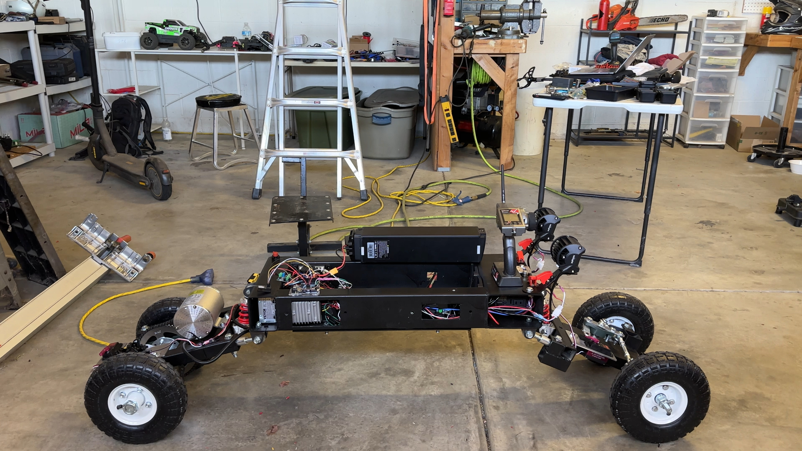

# eskateboard
Was initially a skateboard but was too scary so turned it into a go kart. 

[Everything I bought for the project](https://drive.proton.me/urls/V9PJ7P0EQG#DMEw0mcBIt5R)
[CAD Files](https://cad.onshape.com/documents/9d8c2cabdbe857fefaa9153f/w/220926637459e40756ef38de/e/f286cdeaa6989589f66064a1)

